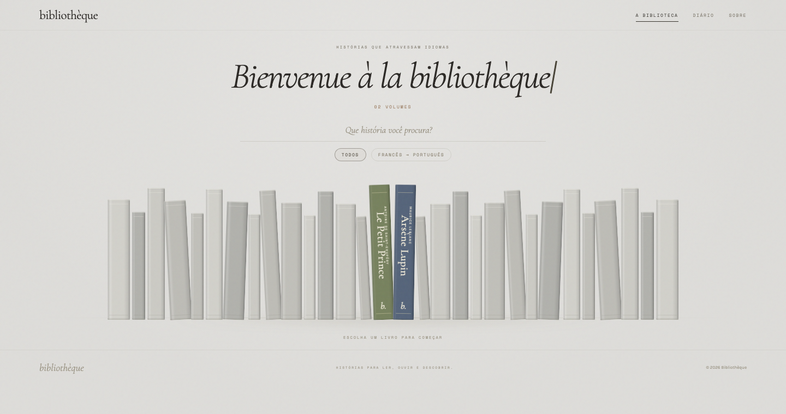
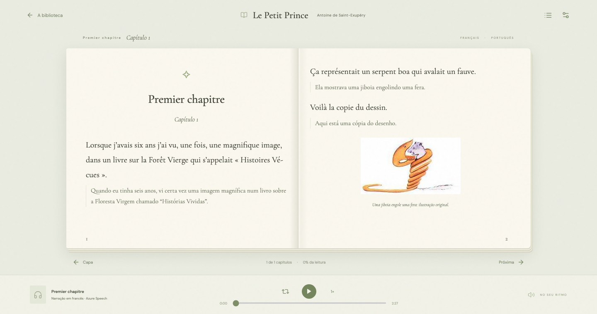
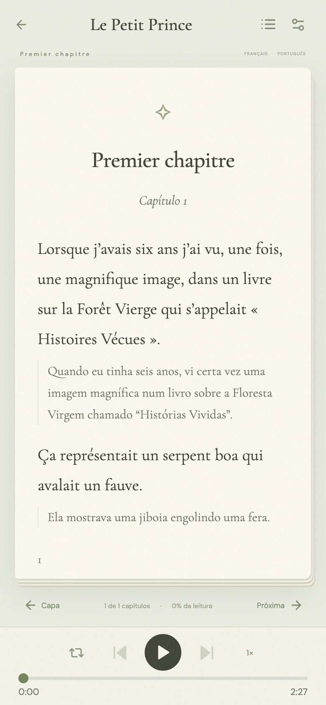
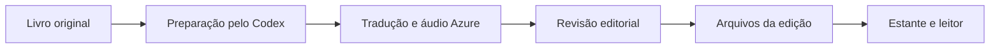

# Bibliothèque

> Uma biblioteca para aprender idiomas com histórias: leia em francês, descubra em português e acompanhe a narração no seu ritmo.

**[Visite a Bibliothèque ↗](https://bibliotheque-self-three.vercel.app/)** · Prévia pública com o primeiro capítulo de _Le Petit Prince_ e o primeiro conto de _Arsène Lupin_.



## What you get

- **Uma estante para explorar:** escolha uma lombada, veja a capa em aquarela e abra o livro com movimento e som de papel.
- **Francês com português abaixo:** páginas ajustáveis, temas claro e escuro e progresso salvo neste navegador. No computador, passar o mouse liga as palavras correspondentes; clicar abre a consulta.
- **Narração sincronizada:** destaque por palavra, velocidade de 0,5× a 2× e pausa durante a virada, com mais dois segundos para localizar o texto. Player adaptado ao celular.
- **Preparação pelo Codex:** importe, traduza, gere áudio e exporte uma edição recuperável.

<table>
  <tr>
    <td width="72%" valign="top"></td>
    <td width="28%" valign="top"></td>
  </tr>
</table>

As imagens mostram a interface real. O Petit Prince tem francês, português e áudio no capítulo piloto. Arsène Lupin oferece o primeiro conto em francês; sua tradução e narração estão em preparação.

## Quick start

Requisito: [Node.js](https://nodejs.org/) 22.12 ou superior.

1. Instale as dependências:

   ```bash
   npm ci
   ```

   O npm instala as versões registradas no lockfile.

2. Abra a biblioteca:

   ```bash
   npm run dev
   ```

   Acesse **http://127.0.0.1:5173**. Selecione _Le Petit Prince_, clique na capa e explore o capítulo piloto. A leitura não exige uma chave Azure.

## How it works



O site lê arquivos já preparados; as chaves e chamadas pagas ficam no fluxo local de edição.

## I want to...

| Quero…                            | Onde começar                                                      |
| --------------------------------- | ----------------------------------------------------------------- |
| Ler o piloto                      | `npm run dev`                                                     |
| Acrescentar um livro com o Codex  | [Preparar um livro](docs/prepare_book.md)                         |
| Configurar Speech e Translator    | [Configuração Azure](docs/prepare_book.md#configurar-a-azure)     |
| Entender publicação e recuperação | [Publicar uma edição](docs/prepare_book.md#preparar-a-publicação) |

## Learn more

- [Documentação](docs/README.md): encontre o guia da tarefa.
- [Contribuição](docs/CONTRIBUTING.md): execute os testes e prepare a distribuição estática.
- [Estado do produto](docs/product_status.md): veja o que está implementado e as aprovações editoriais pendentes.

## Help

Para relatar um problema, registre o capítulo, o trecho e o navegador utilizado em uma [issue](https://github.com/gabisandi/bibliotheque/issues). Não inclua chaves de API nem arquivos editoriais privados.
