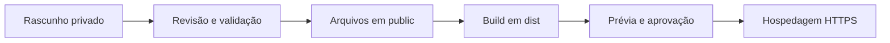

# Bibliothèque - Contributing

> Execute, teste e distribua o leitor e suas ferramentas editoriais.

> [!NOTE]
> Publicação, segurança, glossário e fontes são seções desta página para manter uma única referência de contribuição.

## Jump to

| I want to...          | Go to                                         |
| --------------------- | --------------------------------------------- |
| Preparar o ambiente   | [Get set up](#get-set-up)                     |
| Alterar o projeto     | [Make a change](#make-a-change)               |
| Executar os testes    | [Check your work](#check-your-work)           |
| Gerar a distribuição  | [Ship it](#ship-it)                           |
| Proteger as chaves    | [Stay safe](#stay-safe)                       |
| Localizar o código    | [Find your way around](#find-your-way-around) |
| Consultar um termo    | [Words we use](#words-we-use)                 |
| Consultar referências | [Sources](#sources)                           |

## Get set up

_You will run the project locally._

Use Node.js 22.12 ou superior. Execute `npm ci` para instalar as versões do lockfile. `npm run dev` abre o servidor em `http://127.0.0.1:5173`.

O leitor funciona sem credenciais. Configure o `.env` somente ao usar os serviços Azure, conforme [o guia editorial](prepare_book.md#configurar-a-azure).

## Make a change

_You will change the reader while preserving the editorial files._

Trabalhe em uma branch de funcionalidade. Mantenha a preparação local em `scripts/` e o leitor público em `src/`. Atualize o contrato compartilhado quando mudar o manifesto e preserve os identificadores dos trechos existentes.

Novos comportamentos devem proteger uma garantia observável. Atualize este guia quando os comandos mudarem. Faça commit e push apenas quando solicitados pela proprietária.

## Check your work

_You will check content, compilation and reading interactions._

```bash
npm run check
```

O comando executa testes de contrato e recuperação, verificação TypeScript, build estático e validação do pacote piloto. O resultado esperado é saída sem erros e “Edição válida”.

```bash
npx playwright install chromium
npm run test:e2e
```

Os testes de navegador verificam abertura, consulta, mudança de fonte, retomada e áudio ausente no computador e no celular. Eles usam a prévia local e não chamam serviços pagos. A compilação não depende de segredos.

O projeto não impõe percentual de cobertura. As garantias de conteúdo, publicação, recuperação e sincronização orientam quais testes existem.

## Ship it

_You will publish a recoverable static build._

```bash
npm run check
npm run build
npm run preview
```

O build gera `dist/`; a prévia de produção abre em `http://127.0.0.1:4173`. Distribua somente `dist/` para uma hospedagem estática HTTPS, após aprovação editorial. Não envie a raiz do repositório nem `editorial/`.



A prévia está em [bibliotheque-self-three.vercel.app](https://bibliotheque-self-three.vercel.app/), na conta pessoal `gabisandi` da Vercel. O arquivo `vercel.json` define instalação com `npm ci`, validação e build com `npm run check` e saída `dist/`. Nenhuma chave Azure é necessária na hospedagem. O repositório público é [gabisandi/bibliotheque](https://github.com/gabisandi/bibliotheque). A Vercel está conectada a ele: pushes em `main` disparam a validação e a publicação; branches de trabalho podem gerar prévias. Edite os arquivos no GitHub ou envie commits pelo Codex para atualizar o site. A proprietária aprova a publicação e a restauração. Preserve o build anterior e seus arquivos de edição para rollback; a troca de catálogo deve ocorrer depois do envio dos arquivos referenciados.

## Stay safe

_You will keep sources and credentials private._

### Report a vulnerability

Envie o relato diretamente à proprietária por um canal privado já combinado. Não abra um relato público contendo chaves, arquivos privados ou dados de cobrança. Inclua passos de reprodução e versões afetadas.

### Practices

- `.gitignore` exclui `.env`, fontes, caches e backups privados do Git. `.vercelignore` impede que esses mesmos arquivos entrem em deploys feitos pela CLI; confira os candidatos com `vercel deploy --dry --json` antes de enviar.
- `src/` não importa os módulos Azure de `scripts/`.
- Comandos pagos exigem `--execute` e um teto explícito de caracteres.
- Requisições incertas ficam bloqueadas no cache até reconciliação. Rejeições HTTP 429 confirmadas são registradas separadamente e podem ser retomadas após o prazo do serviço; lotes de tradução são espaçados para evitar rajadas.
- `stage` valida direitos, revisões, arquivos e marcas de áudio antes de preparar a publicação.
- `restore` rejeita caminhos inseguros, arquivos corrompidos e sobrescrita de pastas.
- `npm audit` verifica as dependências; não aplique atualizações destrutivas automaticamente.

## Find your way around

_You will find the code you need to change._

| Pasta        | Responsabilidade                                     |
| ------------ | ---------------------------------------------------- |
| `src/`       | Interface, contrato do manifesto e estado de leitura |
| `scripts/`   | Preparação local, importação, Azure e pacotes        |
| `public/`    | Catálogo e edições servidas pelo site                |
| `tests/`     | Contratos, recuperação e jornadas do leitor          |
| `editorial/` | Material privado local, excluído do Git              |
| `docs/`      | Guias atuais do projeto                              |

## Words we use

_You will understand the terms used in the project._

| Termo       | Significado                                                                |
| ----------- | -------------------------------------------------------------------------- |
| Manifesto   | Arquivo que descreve uma edição e referencia seus textos, imagens e áudios |
| Trecho      | Unidade de texto francês ligada a uma tradução e a uma voz                 |
| Edição      | Versão recuperável de um livro                                             |
| SSML        | Instruções de voz e pronúncia enviadas à síntese de fala                   |
| Fingerprint | Identificador calculado para detectar se o texto falado ou a voz mudou     |
| PCM         | Áudio sem compressão, usado para montar capítulos com tempos exatos        |
| Stage       | Preparar os arquivos e o catálogo locais antes do deploy                   |

## Sources

_You will find the references used by the project._

| Source                                                                                                                     | Applies to     | Why it matters                                |
| -------------------------------------------------------------------------------------------------------------------------- | -------------- | --------------------------------------------- |
| [Virtual Library Guide](https://github.com/carollia99/virtual-library-guide)                                               | Estante e capa | Referência visual fornecida pela proprietária |
| [Watercolor Object](https://github.com/morikyl/skills/blob/main/watercolor-skills/watercolor-obj/SKILL.md)                 | Capa           | Direção artística da coleção                  |
| [Azure Speech](https://learn.microsoft.com/en-us/azure/ai-services/speech-service/how-to-speech-synthesis)                 | Narração       | SDK, arquivo de áudio e eventos por palavra   |
| [Azure Translator](https://learn.microsoft.com/en-us/azure/ai-services/translator/text-translation/reference/v3/translate) | Tradução       | Contrato de lotes e autenticação              |
| [Vite](https://vite.dev/guide/)                                                                                            | Build          | Servidor local e distribuição estática        |

Os repositórios de referência foram consultados em `main` por `gh api`, pois o conector GitHub não estava disponível na sessão de implementação.
